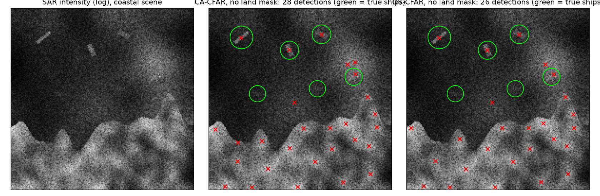
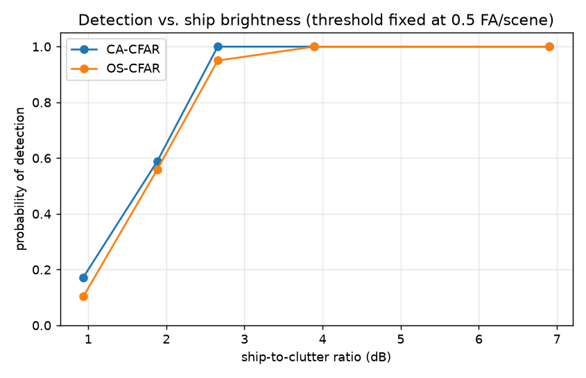

# Ship Detection in SAR Imagery with CFAR: Calibration, Coastlines and Convoys

Maritime surveillance relies on **synthetic aperture radar (SAR)** because it sees through clouds and darkness. Ships appear as small bright objects in noisy, speckled imagery. The standard detector family is **CFAR** (constant false alarm rate): compare each pixel with a local estimate of the sea clutter and flag it if it is far brighter. This project builds and compares the two classic variants on a physically motivated simulator, and tests them the way a coast-guard system would be used: **threshold fixed on open sea, then deployed near a coast and on busy shipping lanes.**



*Left: simulated SAR scene (log scale) with a coastline, bright land and three ships. Middle and right: CA-CFAR and OS-CFAR detections (red x) without a land mask. Green circles are true ships. Almost all false alarms are on land and at its edge.*

## Method

- **Simulator**: multi-look speckle (Gamma-distributed intensity, 4 looks), slowly varying sea clutter level, optional coastline with brighter, textured land, ships as oriented rectangles with a few extra-bright point scatterers. Ship brightness is given as the **ship-to-clutter ratio (SCR)**.
- **CA-CFAR** estimates the clutter as the *mean* of a ring of training cells (31×31 window, 15×15 guard window). **OS-CFAR** uses the *75th percentile* of the same ring, which should ignore a minority of contaminated cells.
- **Post-processing**: merge nearby pixels, drop objects under 3 pixels, optional land mask (smoothed intensity above 2× the scene median, large connected regions only, dilated to exclude the coast edge).
- **Protocol**: thresholds are set once on 20 open-sea scenes (0.5 false alarms per scene), then frozen. Evaluation uses different scenes and seeds (30 per scenario, about 180-240 ships each).

## Results

| | Open sea | Coast, no land mask | Coast, land mask |
|---|---|---|---|
| | Pd · FA/scene | Pd · FA/scene | Pd · FA/scene |
| CA-CFAR | 0.84 · 0.23 | 0.81 · **23.7** | 0.78 · 2.2 |
| OS-CFAR | 0.82 · 0.23 | 0.79 · **22.4** | 0.77 · 1.8 |

(Pd = share of ships detected, FA = false alarms per scene. Ships have SCR 1.1-8, i.e. 0.4-9 dB.)

- **The coastline is the real problem.** The same threshold that gives 0.23 false alarms over open sea gives about **100× more** near land. A simple land mask removes 90% of them at a cost of 3 points of Pd, and remaining false alarms are mostly bright sea patches.
- The mask is a trade-off, not a free fix: on separate tuning scenes it covered 99% of the land but also masked 3.3% of the open sea, and **a ship less than about 25 px from the coast can be lost** (2 of 240 ships in a check).



Detection falls from nearly 100% above 3 dB to about 15% at 1 dB, with a knee at 1.5-2.5 dB.

### Do close neighbours blind the detector? (SCR 1.7, near the knee)

| | Isolated | Close pair | Convoy of 4 |
|---|---|---|---|
| CA-CFAR Pd | 0.81 | 0.83 | **0.65** |
| OS-CFAR Pd | 0.75 | 0.78 | **0.63** |
| CA mean CFAR ratio on ship pixels | 1.82 | 1.73 (−5%) | 1.69 (−7%) |
| OS mean CFAR ratio on ship pixels | 1.43 | 1.37 (−4%) | 1.34 (−6%) |

Neighbours inside the training ring raise the clutter estimate (**target masking**) and a convoy of four costs both detectors 12-16 points of Pd.

**OS-CFAR did not beat CA-CFAR here, contrary to the textbook expectation.** Its Pd is equal or a few points lower in every scenario, and its relative loss in the convoy is only slightly smaller (−16% vs −20% in Pd). With 180-240 ships per cell the standard error is about 3 points, so these gaps are 1-2 standard errors: **not conclusive in either direction**. A stronger OS advantage would need denser traffic (more than ~25% of the ring contaminated) or a clutter edge crossing the ring, neither of which this benchmark stresses much.

### What changed during development

The first benchmark was too easy and saturated (every ship above 3 dB detected by both detectors, CA and OS identical), so it could not discriminate. The ship brightness range and the pair/convoy scenarios were moved to the detection knee **before** reading any CA-vs-OS result. A first land-mask version also deleted bright ships (smoothed ships exceeded the "land" level); it now keeps only large connected regions.

## Limitations

- Simulated, single-polarisation, single-resolution scenes. Real SAR has ambiguities, sidelobes, wakes, azimuth smearing, sea-state-dependent clutter statistics (K or G0 distributions rather than Gamma) and inhomogeneous land cover.
- The land mask is a heuristic. Real systems use coastline databases or learned segmentation.
- Detection only: no ship length, heading or classification. Modern systems add a CNN on candidate chips.

## Project structure

```
src/sarship/
  sim.py       # speckle, clutter, coastline, ships, pairs and convoys
  detect.py    # CA-CFAR, OS-CFAR, land mask, thresholding and merging
  evaluate.py  # calibration on open sea, scenario evaluation, ROC and figures
tests/         # speckle statistics, CFAR ratio levels, detection, land mask, masking effect, matching
```

## Quickstart

```bash
python -m venv .venv && source .venv/bin/activate
pip install -r requirements.txt
PYTHONPATH=src python -m sarship.evaluate
pytest
```

## Tech stack

Python · NumPy · SciPy · Matplotlib · pytest

---

### 🇹🇷 Türkçe özet

Sentetik aranjman açıklıklı radar (SAR) görüntülerinde gemi tespiti: lekelenme (speckle) modeli, değişken deniz karmaşası, kıyı şeridi ve gemi konvoyları içeren bir simülatörde klasik CFAR dedektörlerinin (CA ve OS) karşılaştırması. Eşik açık denizde kalibre edilip kıyıda ve yoğun trafikte dondurularak test ediliyor. Bulgular: kıyıda aynı eşik yaklaşık **100 kat** daha fazla yanlış alarm veriyor, basit bir kara maskesi bunun %90'ını temizliyor (kıyıya çok yakın gemileri kaybetme riskiyle). Dört gemilik bir konvoy her iki dedektörün tespit oranını 12-16 puan düşürüyor. Beklentinin aksine OS-CFAR, CA-CFAR'ı geçemedi; fark istatistiksel olarak anlamlı değil.
